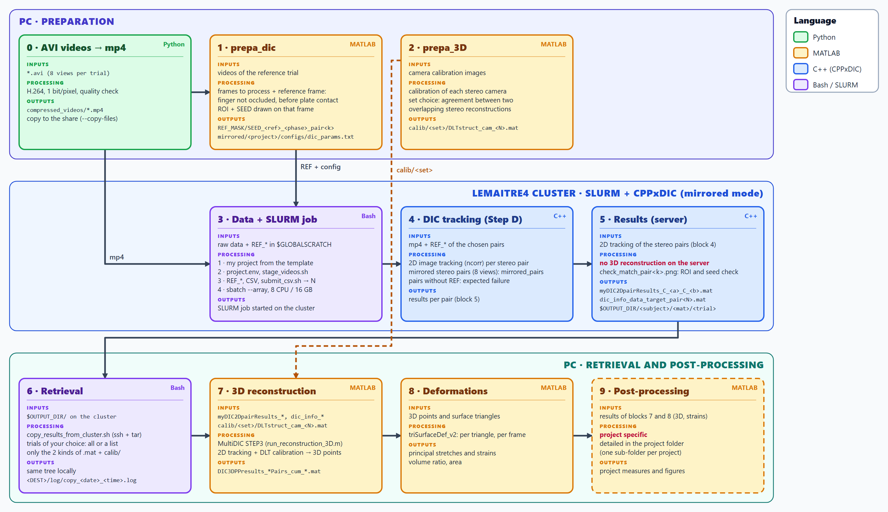
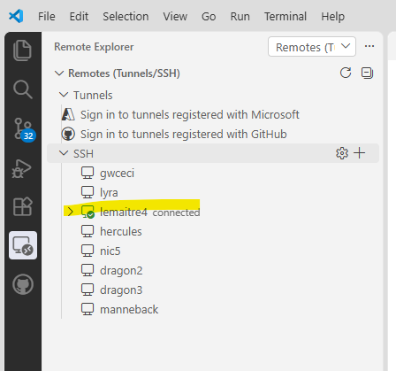
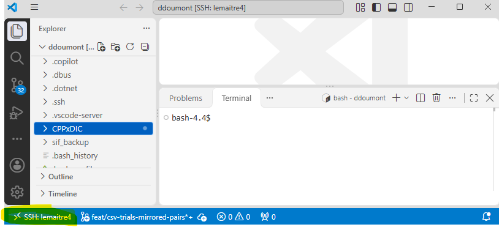
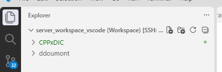

# CPPxDIC on the CÉCI cluster: setup guide

Draft v1, 2026-11-23. Written from a working setup on `lemaitre4`.

## Summary

- **What this is**: the shortest path from "I have a CÉCI account" to "my first trials ran on the cluster", with VS Code as the working environment.
- **What you do, in order**: [Part A](#part-a-one-time-setup) set up once (SSH, VS Code, code, container image, data folders) → [Part B](#part-b-create-your-project-from-the-template) create your own project from a template → [Part C](#part-c-run-trials) run trials → [Part D](#part-d-adjust-the-parameters) adjust parameters → [Part E](#part-e-git-updates-and-contributions) get updates and share changes.
- **You do not need** to understand the C++ code or the full README of the repository to launch jobs. Each part links to the README that has the details.
- **Basis**: the commands come from what ran on 18–19 Nov 2026 (13 trials, 9 finished, 2 failed, 2 hit the time limit; see [Troubleshooting](#troubleshooting)).

## Where you are in the pipeline



The diagram shows the whole data-processing pipeline. This guide covers the cluster part (**blocks 3, 4, 5**) and getting the results back (**block 6**). Blocks 0 to 2 (video conversion, ROI and seed in MATLAB, calibration) are done on your PC before you start; block 6 onward (3D reconstruction, strain, post-processing) is done on your PC afterwards. Every part below starts with a line "**You are here: block N**".

| Block | What happens | Where | In this guide |
|---|---|---|---|
| 0–2 | videos to mp4, ROI and seed (`REF_MASK_*`, `REF_SEED_*`), calibration | PC | only what you must copy ([A8](#a8-copy-your-raw-data), [A9](#a9-copy-the-reference-files-ref_mask-and-ref_seed)) |
| 3 | data on the cluster + SLURM job | cluster | [Parts A–C](#part-a-one-time-setup) |
| 4 | DIC tracking (the job itself) | cluster | [C6](#c6-submit-the-job) |
| 5 | results on the cluster | cluster | [C8](#c8-look-at-the-results) |
| 6 | copy results back to the PC | PC | [C9](#c9-copy-the-results-to-your-pc) |

## Conventions

- `<login>` is your CÉCI login, `<project>` your project name, `<dataset>` the folder that holds all your subjects (for example `slip_and_roll`), `<subject>` one subject folder inside it (for example `DD3_osc`; this is also what the CSV column `subject` and the `-e` option of `copy_results_from_cluster.sh` mean). The folder name `glass` that appears in some paths is fixed (the program reads it).
- `$GLOBALSCRATCH` is a variable the cluster sets for you at login. It points to your large working space, for example `/globalscratch/ucl/inma/<login>`. Check it: `echo $GLOBALSCRATCH`.
- A command is in a grey block. The **principle** is one sentence below the title; **expected output** follows in a `text` block (your numbers will differ).
- 📷 marks a place where a screenshot helps. The list of screenshots to take is in [Appendix A](#appendix-a-screenshots-to-take).

---

## Part A: One-time setup

**You are here: before block 3 (preparing your account, code and folders).**

### A1. Account and SSH

You need a CÉCI account with your SSH public key registered, and a working `ssh lemaitre4` from your PC. Follow [ceci_vscode_ssh_setup.md](ceci_vscode_ssh_setup.md), sections [0 to 3](ceci_vscode_ssh_setup.md#0-what-you-need). Do not continue until this works in a plain terminal:

```bash
ssh lemaitre4
```

Principle: the cluster is reached through a gateway; once the terminal works, VS Code will work too.

```text
[<login>@lemaitre4 ~]$
```

### A2. Connect VS Code to the cluster

Install the *Remote - SSH* extension, then *Remote-SSH: Connect to Host…* → `lemaitre4`. Details and the VS Code settings that matter on a shared login node (disable AI features on the remote, one window only) are in [sections 4 and 5 of the SSH guide](ceci_vscode_ssh_setup.md#4-connect-from-vs-code).

📷 

📷


### A3. Create a VS Code workspace (recommended)

Principle: a workspace saves "which folders are open", so each time you reconnect you get your code and your data side by side. The code lives in your home, the data in the globalscratch (see [A7](#a7-where-data-and-results-live-the-globalscratch)).

1. In the VS Code terminal: `echo $GLOBALSCRATCH` and note the path.
2. *File > Open Folder…* → `~/CPPxDIC` (after [A4](#a4-get-the-code)).
3. *File > Add Folder to Workspace…* → the `$GLOBALSCRATCH` path.
4. *File > Save Workspace As…* → `~/cppxdic.code-workspace`.

Next time: *File > Open Workspace from File…* → `~/cppxdic.code-workspace`. The file looks like this (replace the second path by your own):

```json
{
    "folders": [
        { "path": "CPPxDIC" },
        { "path": "/globalscratch/ucl/inma/<login>" }
    ],
    "settings": {}
}
```

Why it is useful here: you edit the CSV and the parameter files, read the job logs, and open the control images (`.png`) in the same window.

Keep the folder small: do not add a folder with thousands of files (see [section 5 of the SSH guide](ceci_vscode_ssh_setup.md#5-recommended-vs-code-settings-important-on-shared-login-nodes)).

📷

### A4. Get the code

Principle: you work on a clone of Donatien's fork, so that you and the other contributors share the same code and projects. Your project is added to it later ([Part B](#part-b-create-your-project-from-the-template), [Part E](#part-e-git-updates-and-contributions)).

```bash
git clone -b feat/csv-trials-mirrored-pairs git@github.com:donatiendoumont/CPPxDIC.git ~/CPPxDIC
```

```text
Cloning into '/home/ucl/inma/<login>/CPPxDIC'...
...
```

**Prerequisites (to do once on GitHub)**: Donatien gives you write access to the fork (*Settings > Collaborators*), and your SSH key is added to your GitHub account (the key used on the cluster, or a second one). Test with `ssh -T git@github.com`: it must answer `Hi <your-github-name>! You've successfully authenticated`.

Then check the remotes:

```bash
cd ~/CPPxDIC && git remote -v
```

```text
fork    git@github.com:donatiendoumont/CPPxDIC.git (fetch)
fork    git@github.com:donatiendoumont/CPPxDIC.git (push)
origin  https://github.com/xdic-dev/CPPxDIC.git (fetch)
origin  https://github.com/xdic-dev/CPPxDIC.git (push)
```

(After a fresh `git clone` you may only see `origin` pointing to the fork. This is fine: use whatever name `git remote -v` shows for the fork when you push, see [Part E](#part-e-git-updates-and-contributions).)

Repository READMEs for background (you do not need them to launch jobs): [README.md](https://github.com/donatiendoumont/CPPxDIC/blob/feat/csv-trials-mirrored-pairs/README.md), [deploy/cluster/README.md](https://github.com/donatiendoumont/CPPxDIC/blob/feat/csv-trials-mirrored-pairs/deploy/cluster/README.md), [deploy/cluster/README_trial_arrays.md](https://github.com/donatiendoumont/CPPxDIC/blob/feat/csv-trials-mirrored-pairs/deploy/cluster/README_trial_arrays.md).

### A5. Build the container image (once)

Principle: the program is baked into a container image (`.sif`) once; the parameters stay outside the image, so you never rebuild to change a parameter (see [deploy/cluster/README.md](https://github.com/donatiendoumont/CPPxDIC/blob/feat/csv-trials-mirrored-pairs/deploy/cluster/README.md)). The build runs on a compute node, not on the login node.

```bash
cd ~/CPPxDIC && srun --cpus-per-task=8 --mem=16G --time=00:10:00 apptainer build --fakeroot deploy/cluster/cppxdic_mirrored.sif deploy/cluster/cppxdic_mirrored.def
```

It takes about 5 minutes (the build used a 10-minute limit twice; 10 min is a safe margin). Check that the file exists:

```bash
ls -lh ~/CPPxDIC/deploy/cluster/cppxdic_mirrored.sif
```

```text
-rwxr-xr-x 1 <login> <group> 509M ... deploy/cluster/cppxdic_mirrored.sif
```

(The reference image was about 530 MB.) Rebuild only when the C++ code changes ([Part E](#part-e-git-updates-and-contributions)).


### A6. Tell the shell where the image is

Principle: the job script reads the image path from two environment variables, set once in `~/.bashrc`.

```bash
printf '\nexport SIF_IMAGE=$HOME/CPPxDIC/deploy/cluster/cppxdic_mirrored.sif\nexport SINGULARITY_IMAGE=$SIF_IMAGE\n' >> ~/.bashrc && source ~/.bashrc
```

Check:

```bash
echo $SIF_IMAGE
```

```text
/home/ucl/inma/<login>/CPPxDIC/deploy/cluster/cppxdic_mirrored.sif
```

Put nothing else in `~/.bashrc`: everything that depends on the project comes from your `project.env` ([Part B](#part-b-create-your-project-from-the-template)).


### A7. Where data and results live: the globalscratch

**Put the raw data, the staged data and the results in `$GLOBALSCRATCH`, never in your home.** Principle: the home is small; the globalscratch is the large working space of the cluster. One video set is several GB (for example 7.3 GB for one subject of 91 videos).

| What | Where | Variable |
|---|---|---|
| code, container image, job logs | `~/CPPxDIC` (home) | |
| raw data (copied from your PC) | `$GLOBALSCRATCH/data/<dataset>/<subject>/…` | `$RAW_DIR` |
| staged data (renamed videos, protocol) | `$GLOBALSCRATCH/data_staged/<project>/` | `$DATA_DIR` |
| results | `$GLOBALSCRATCH/analysis/<project>/` | `$OUTPUT_DIR` |

You do not type these paths: they are set by your `project.env` ([Part B](#part-b-create-your-project-from-the-template)) from `$GLOBALSCRATCH`.

Treat the globalscratch as **not backed up**: copy your results to your PC ([C9](#c9-copy-the-results-to-your-pc)).

### A8. Copy your raw data

**You are here: block 3, data on the cluster.**

Principle: one folder per subject, copied as it is from your PC, with this structure (the same as on the PC):

```text
$GLOBALSCRATCH/data/<dataset>/
└── <subject>/
    ├── vid/        *.mp4        (one file per trial and camera)
    ├── protocol/   *.tsv        (one protocol per subject)
    ├── calib/                   (kept, not read by the cluster job)
    └── robot/                   (kept, not read by the cluster job)
```

The copy runs from a terminal **on your PC** (PowerShell), because the data are on your PC. `$GLOBALSCRATCH` only exists on the cluster, so on your PC you write its value out: for everyone in the INMA group it is `/globalscratch/ucl/inma/<login>` (only your login changes).

Create the destination, then copy one subject:

```powershell
ssh lemaitre4 "mkdir -p /globalscratch/ucl/inma/<login>/data/<dataset>"
scp -r "<local_folder>\<subject>" lemaitre4:/globalscratch/ucl/inma/<login>/data/<dataset>/
```

It can take a while for several GB. `<local_folder>` is where the subject folder is on your PC. The `<dataset>` folder name is the one you will write in `RAW_DIR` ([Part B](#part-b-create-your-project-from-the-template)).

Video names look like `slip_and_roll_DD3_001_2006_050_trial003_cam_1.mp4`; the next step renames them so the trial number cannot be mixed up with other numbers.

**Microneurography (MNG) data.** The folder is organised differently: `expe008` is one subject, and below it the trial variants are separated by acquisition unit and block (`expe008/cam/U01/vid/`, `expe008/cam/U03/vid/`, and `expe008/protocol/`). Copy the whole `expe008` folder as it is, with the same `scp` command. Staging ([C2](#c2-stage-the-videos)) then creates one *staged subject* per unit and block, for example `expe008_U01_block1`; this staged name is the one you write in the `subject` column of the CSV.

### A9. Copy the reference files (REF_MASK and REF_SEED)

Principle: the ROI mask and the seed point of each camera pair come from your MATLAB preparation (block 1). They must be on the cluster before the job: one pair of files per camera pair, named `REF_MASK_<trial>_whole_slide_pair<k>.mat` and `REF_SEED_<trial>_whole_slide_pair<k>.mat`, in:

```text
$OUTPUT_DIR/<subject>/glass/
```

- `<trial>` is the **reference trial** (the trial on which you drew the mask and the seed), written in the file name with 3 digits (`001`).
- `pair<k>` is the **camera pair number** (`pair1`, `pair3`, ...): one mask and one seed per pair.
- The phase in the name is always `whole_slide`, whatever the phase you track: it is a leftover of the code, keep it as it is.
- The folder is `glass` (also a leftover, but the program reads it).

(`$OUTPUT_DIR` exists once your project is created, [Part B](#part-b-create-your-project-from-the-template). Create the folder with `mkdir -p`, then `scp` the files into it.) Example of a real folder:

```text
REF_MASK_001_whole_slide_pair1.mat    REF_SEED_001_whole_slide_pair1.mat
REF_MASK_001_whole_slide_pair3.mat    REF_SEED_001_whole_slide_pair3.mat
...
```

A camera pair without its two files fails alone; the other pairs of the trial still run.

> **Where you are now (end of Part A).** Your account, VS Code workspace, code, container image and shell variables are ready, and your raw data and `REF_*` files are in the globalscratch. This part is done **once**. No project exists yet, so nothing can be launched.
>
> **What you can do next:**
> - [Part B](#part-b-create-your-project-from-the-template): create your project from the template (two lines to edit). This is the only way forward;
> - if a step above did not give the expected output, fix it now: later parts depend on it ([Troubleshooting](#troubleshooting)).

---

## Part B: Create your project from the template

**You are here: block 3, project and paths.**

Principle: everything that depends on your project (paths, parameters, CSV, frame script) lives in **one folder** under `deploy/cluster/mirrored/`. You copy the template folder and edit two lines. There is no default project: you choose yours in every new shell. `osc/` and `rolling/` are Donatien's projects; you do not use them.

```bash
cp -r ~/CPPxDIC/deploy/cluster/mirrored/template ~/CPPxDIC/deploy/cluster/mirrored/<project>
```

In VS Code, open `deploy/cluster/mirrored/<project>/project.env` and edit **only** the two lines marked `EDIT`:

```bash
export PROJECT_NAME=my_project                       # EDIT 1: your project name
export RAW_DIR="${_pe_g}/data/my_dataset"         # EDIT 2: the <dataset> folder of A8
```

Then activate it (once per terminal):

```bash
source ~/CPPxDIC/deploy/cluster/mirrored/<project>/project.env
```

```text
project=<project>  PROJECT_DIR=/home/.../mirrored/<project>  DATA_DIR=/globalscratch/.../data_staged/<project>  OUTPUT_DIR=/globalscratch/.../analysis/<project>
```

A terminal keeps the variables of the last `project.env` it sourced: check with `echo $PROJECT_NAME`.

The project folder contains:

| File | Role |
|---|---|
| `project.env` | paths and variables of the project (you edited it) |
| `configs/` | `dic_params.txt`, `ncorr_params.txt`, `visualization_params.txt` (see [Part D](#part-d-adjust-the-parameters)) |
| `template_project.csv` | model of the trial list (copied in [C3](#c3-write-the-trial-list)) |

More details in [deploy/cluster/mirrored/README.md](https://github.com/donatiendoumont/CPPxDIC/blob/feat/csv-trials-mirrored-pairs/deploy/cluster/mirrored/README.md). Commit your project folder to the fork ([Part E](#part-e-git-updates-and-contributions)) so the others can see it.

📷 `09_project_env_echo`.

> **Where you are now (end of Part B).** Your project folder exists, `project.env` points to your dataset, and the shell has your project variables (`echo $PROJECT_NAME` shows its name). Nothing has run on the cluster yet.
>
> **What you can do next:**
> - [Part C](#part-c-run-trials): stage the videos, write the trial list, submit the job;
> - if the raw data or the `REF_*` files are not on the cluster yet: [A8](#a8-copy-your-raw-data) and [A9](#a9-copy-the-reference-files-ref_mask-and-ref_seed) first;
> - optional: adjust the parameters before the first run ([Part D](#part-d-adjust-the-parameters)); the defaults are fine for a first run.

---

## Part C: Run trials

Do these steps in order, each time. They are the same for every project.

### C1. Activate the project

```bash
source ~/CPPxDIC/deploy/cluster/mirrored/<project>/project.env
```

(Output as in [Part B](#part-b-create-your-project-from-the-template).)

### C2. Stage the videos

**You are here: block 3, staging.**

Principle: copy and rename the videos, and copy the protocol, into the folder layout the program expects. The source is never modified. Always run it first **without** `--apply` (a dry run that writes nothing):

```bash
bash ~/CPPxDIC/deploy/cluster/stage_videos.sh --src-root $RAW_DIR --dst-root $DATA_DIR --subject <subject>
```

```text
  slip_and_roll_DD3_001_2006_050_trial003_cam_1.mp4  ->  DD3_osc_glass_speckles_001_F2006S050_cam_1.mp4
  ...
Matched: 91   skipped: 0   excluded: 0   duplicates: 0
Name prefix : slip_and_roll_DD3
Protocol    : .../data/.../<subject>/protocol  ->  .../data_staged/<project>/rawdata/<subject>/speckles/glass/protocol
(dry run: nothing written. Re-run with --apply to copy.)
```

Check that `skipped` is 0 and the number matched is what you expect. Then run **the same command with `--apply` added at the end**.

**MNG (microneurography) data** have their own script, `stage_video_mng.sh`, because the folders and file names differ (`<expe>/cam/<unit>/vid/`, one protocol per block). One call stages one unit and creates one staged subject per block (`expe008_U01_block1`, `expe008_U01_block2`, ...), each with its protocol `MNG_Block<N>*.tsv`. Same rule: dry run first, then `--apply`:

```bash
bash ~/CPPxDIC/deploy/cluster/stage_video_mng.sh --src-root $RAW_DIR --dst-root $DATA_DIR --expe expe008 --unit U01
```

If two acquisitions share a trial number, the script stops and tells you; the option `--exclude-prefix` is explained in [useful_bash_line_command_en.md](useful_bash_line_command_en.md).

📷 `08_stage_dry_run`.

### C3. Write the trial list

**You are here: block 3, CSV.**

Principle: one CSV says which subject, trial and phase to process. You copy the template and edit the copy (the template itself is never changed):

```bash
cp $PROJECT_DIR/template_project.csv $PROJECT_DIR/subject_trial.csv
```

Open `subject_trial.csv` in VS Code (Explorer → click on the file). The template looks like this:

```text
subject,trial,phase,frame_jump
my_subject,1:3,4,
my_subject,"[5,7]",3+4,2
```

| Column | Meaning |
|---|---|
| `subject` | the subject folder name |
| `trial` | `5`, `1:3` (range), or `"[1,2,7]"` (list, **between quotes**) ; one row per trial is generated |
| `phase` | the movement number(s) of the protocol to keep: `4`, `3+4`, `3:5` |
| `frame_jump` | `1` = every image, `2` = one image out of two; empty = value of `dic_params.txt` |

Every column, the named phases of other protocols and the oscillation options are described in [useful_bash_line_command_en.md](useful_bash_line_command_en.md) (section "CSV columns").

📷 `10_csv_in_vscode`.

### C4. Compute the frame windows

**You are here: block 3, frame windows.**

Principle: the script reads your CSV and the protocol copied in C2, computes the first and last frame of each trial, and writes a second CSV `*_staged.csv` next to yours. It also sets two variables, `CSV` and `N` (the number of trials), used by the next command. Always give the CSV explicitly.

```bash
source ~/CPPxDIC/deploy/cluster/submit_csv.sh $PROJECT_DIR/subject_trial.csv
```

```text
Frame script: /home/.../deploy/cluster/frame_standard_complete.sh
Step 1: 5 (subject, trial) row(s) after expansion (2 trial cell(s) expanded).
  ...
Written: .../mirrored/<project>/subject_trial_staged.csv
CSV=.../mirrored/<project>/subject_trial_staged.csv
N=5
```

(Real output also shows the frame windows found in the protocol. The example above is the template's trial expansion.) `N` must equal the number of trials you want.

📷 `11_submit_csv_output`.

### C5. (Optional) Try one trial first

Edit your CSV so it has a single trial, rerun C4 (so `N=1`) and run C6. A first run on one trial costs less than discovering a problem on many.

### C6. Submit the job

**You are here: block 3 → block 4 (the job starts the DIC tracking).**

Principle: one job array, one task per trial. The number of CPUs must match `step_d_total_threads` in `dic_params.txt` (8 by default). The time limit is per task.

```bash
cd ~/CPPxDIC && sbatch --array=1-${N} --cpus-per-task=8 --mem=16G --time=02:00:00 --export=ALL,SUBJECT_TRIAL_CSV=$CSV,WORKDIR=$CONFIG_DIR deploy/cluster/run_subject_trial_array.sbatch
```

```text
Submitted batch job 8182415
```

Time limit: trials of about 376 frames took up to **1 h 51** with 8 threads (limit 2 h). For long trials use `--time=04:00:00`.

📷 `12_sbatch_squeue`.

### C7. Follow the job

Principle: `squeue` lists your jobs (`PD` pending, `R` running); the logs are in `~/CPPxDIC/logs/`, one `.out` and one `.err` per task.

```bash
squeue --me
```

```text
 JOBID PARTITION     NAME     USER ST       TIME  NODES NODELIST(REASON)
 8182415_1  batch cppxdic-st <login>  R       5:12      1 lm4-w019
```

Read a log from VS Code (open `~/CPPxDIC/logs/cppxdic_st_<jobid>_<task>.out`). A healthy start:

```text
[INFO ] [SLURM array] task 1 -> subject <subject>, trial 1
[INFO ] Subject: <subject>, Phase: whole_slide, Material: glass, Stereo Pairs: 4
[INFO ] Pairs: [1,3,5,7]
```

and a finished task ends with:

```text
[INFO ] --- pair 7 done; results in /output/<subject>/glass/001/whole_slide/mirrored_pair7 ---
[INFO ] Mirrored-camera analysis completed.
[INFO ] End of script
```

(`/output` is the name of `$OUTPUT_DIR` inside the container.) When the job is over, get a summary:

```bash
sacct -X -j <jobid> -o JobID,State,Elapsed,ExitCode
```

```text
8182415_1   COMPLETED  00:55:18  0:0
8182415_2   FAILED     00:30:28  1:0
8182415_10  TIMEOUT    02:00:12  0:0
```

`COMPLETED` with `0:0` is a finished task. For the others see [Troubleshooting](#troubleshooting).

📷 `13_log_pairs_line`, `16_sacct_completed`.

### C8. Look at the results

**You are here: block 5 (results on the cluster).**

Results are in `$OUTPUT_DIR/<subject>/glass/<trial>/whole_slide/mirrored_pair<k>/`, one folder per camera pair:

```text
check_match_pair7.png
dic_info_data_target_pair7.mat
myDIC2DpairResults_C_8_C_7.mat
ncorr7.bin  ncorr8.bin  ncorr87.bin
```

**Open `check_match_pair<k>.png` in VS Code**: it shows the reference image and the second view side by side, each with its ROI outline and the seed point. It is the quickest way to see that the ROI and the seed are well placed.

📷 `14_check_match_png_in_vscode`, `15_result_tree`.

### C9. Copy the results to your PC

**You are here: block 6 (back to the PC).**

Principle: tar over ssh, works in Git Bash on Windows. Run it **on your PC**, from `~/CPPxDIC/deploy/cluster/` if you cloned it there too, or after downloading the script from the repository. The login, the analysis folder and the host can be set once as variables:

```bash
export CLUSTER_HOST=lemaitre4 CLUSTER_USER=<login> CLUSTER_REMOTE_ROOT=/globalscratch/ucl/inma/<login>/analysis/<project>
./copy_results_from_cluster.sh -e <subject> -d /d/data/results -t all -b
```

(`-b` skips the large `ncorr*.bin` files; `-n` lists what would be copied without copying.) More options in the header of the script.

> **Where you are now (end of Part C).** Your trials ran, the results are in `$OUTPUT_DIR/<subject>/glass/<trial>/` on the cluster and, after C9, a copy is on your PC. The cluster part of the pipeline (blocks 3 to 5) is finished for these trials.
>
> **What you can do from now on:**
> - on your PC: 3D reconstruction, strain and post-processing (blocks 7 to 9 of the diagram; not covered here);
> - trials that failed or hit the time limit: [Troubleshooting](#troubleshooting), then rerun only those tasks ([C6](#c6-submit-the-job));
> - results look wrong or incomplete: change the parameters ([Part D](#part-d-adjust-the-parameters));
> - new subject or trials: add rows to the CSV and repeat [C2](#c2-stage-the-videos) to [C6](#c6-submit-the-job).

---

## Part D: Adjust the parameters

**You are here: block 4, tracking parameters.**

Principle: parameters live in **your project folder**, not in the image: edit, save, rerun. No rebuild. Open `deploy/cluster/mirrored/<project>/configs/` in VS Code; each key has a comment. For a first run, keep the defaults. The ones you are most likely to touch:

| What | Where | Note |
|---|---|---|
| number of threads | `step_d_total_threads` in `dic_params.txt` | must equal `--cpus-per-task` of the `sbatch` line |
| subset spacing and radius | `step_d_spacing`, `step_d_radius` | smaller spacing = more points, slower |
| frames used | `frame_jump` column of the CSV | `2` = half the images |
| seed acceptance gate during tracking | `cutoff_max_corrcoef` in `ncorr_params.txt` | raise it if a seed is refused ("could not seed") |

**Important**: when you change a parameter and rerun a trial that already has results, delete the `mirrored_pair*` folders of that trial first. Otherwise the previous results are reloaded silently and your change has no effect. Ask before deleting anything you are unsure about.

More in the commented parameter files and in [deploy/cluster/mirrored/README.md](https://github.com/donatiendoumont/CPPxDIC/blob/feat/csv-trials-mirrored-pairs/deploy/cluster/mirrored/README.md). Command-line tricks (monitoring, memory, cancelling jobs, other staging options) are in [useful_bash_line_command_en.md](useful_bash_line_command_en.md) (English translation of the French original).

> **Where you are now (end of Part D).** You know where the parameters are and that a change needs the old `mirrored_pair*` folders deleted before a rerun.
>
> **What you can do next:**
> - rerun the trials that changed: back to [C6](#c6-submit-the-job) (same `sbatch` line, with the same `$CSV` and `$N` if the shell is still open; otherwise redo [C1](#c1-activate-the-project) and [C4](#c4-compute-the-frame-windows));
> - compare the new `check_match_pair<k>.png` with the old ones ([C8](#c8-look-at-the-results));
> - keep the working parameters in your project folder and save them to git ([Part E](#part-e-git-updates-and-contributions)).

---

## Part E: Git: updates and contributions

Principle: the code and the projects are shared through the fork on GitHub. Other contributors (including John, who wrote most of CPPxDIC) keep adding changes.

| Goal | Command |
|---|---|
| get the latest changes | `cd ~/CPPxDIC && git pull` |
| work on your own branch | `git switch -c <your_branch>` |
| save your project | `git add deploy/cluster/mirrored/<project> && git commit -m "add <project>"` |
| share it | `git push -u origin <your_branch>` (use the remote name shown by `git remote -v` for the fork) |

Rules of thumb:

- Do not edit another person's project folder or the C++ code without telling them.
- The container image must be **rebuilt** ([A5](#a5-build-the-container-image-once)) when the C++ code changed after a `git pull`. A parameter change never needs a rebuild.

> **Where you are now (end of Part E).** You have the whole loop: set up once, project, runs, parameters, and a way to share and update. Your project is saved in the fork.
>
> **What you can do from now on:**
> - run a new subject or trial: [Part C](#part-c-run-trials) again (new rows in the CSV; no setup);
> - start another project (another dataset or protocol): [Part B](#part-b-create-your-project-from-the-template) again, from the template;
> - something failed: [Troubleshooting](#troubleshooting);
> - after a `git pull` that touched the C++ code: rebuild the image ([A5](#a5-build-the-container-image-once)).
> - The next steps (3D reconstruction, strain, post-processing) happen on your PC, outside this guide (blocks 7 to 9 of the diagram).

---

## Troubleshooting

| Symptom | What it means | What to do |
|---|---|---|
| `ERROR: GLOBALSCRATCH is not set` | the variable is missing | log in again; check `echo $GLOBALSCRATCH` |
| `ERROR: give the source CSV` | `submit_csv.sh` needs the CSV | add `$PROJECT_DIR/subject_trial.csv` |
| `ERROR: FRAME_SCRIPT is not set` | no project activated in this terminal | run C1 |
| `TIMEOUT` in `sacct` | the task hit the `--time` limit | resubmit **only those tasks** with a larger limit: `--array=10,11 --time=04:00:00` (same other options). Finished pairs are kept (checkpoints `ncorr*.bin`). |
| `could not seed the segment` in the `.err` of a task | the seed point is refused by the quality gate at the start of a tracking segment | open the control image; if the seed is badly placed, redo it in MATLAB; otherwise raise `cutoff_max_corrcoef` ([Part D](#part-d-adjust-the-parameters)) and delete that trial's `mirrored_pair*`. |
| job stays `PD` | waiting for resources | `squeue --me --start` gives an estimate |
| `bash: fork: Resource temporarily unavailable` | VS Code uses too many processes on the login node | [section 6 of the SSH guide](ceci_vscode_ssh_setup.md#6-troubleshooting) |

---

## Appendix A: Screenshots to take

Save them in `images/` with these names, then add `` where the 📷 mark is. Blur your login and any key fingerprint.

| File | Step | What must be visible |
|---|---|---|
| `01_vscode_remote_ssh_pick_host.png` | A2 | the host list with `lemaitre4` |
| `02_first_ssh_login.png` | A2 | terminal after login |
| `03_workspace_two_folders.png` | A3 | Explorer with `CPPxDIC` and the globalscratch folder |
| `04_git_clone_done.png` | A4 | end of the `git clone` output |
| `05_sif_built.png` | A5 | `ls -lh` of the `.sif` |
| `06_bashrc_exports.png` | A6 | the two `export` lines in `~/.bashrc` |
| `07_scp_raw_data.png` | A8 | the `scp` command and its progress |
| `08_stage_dry_run.png` | C2 | the dry-run summary (`Matched: … skipped: 0`) |
| `09_project_env_echo.png` | B | `source project.env` and its line |
| `10_csv_in_vscode.png` | C3 | the CSV open in VS Code |
| `11_submit_csv_output.png` | C4 | the `CSV=` and `N=` lines |
| `12_sbatch_squeue.png` | C6 | `Submitted batch job` and `squeue --me` |
| `13_log_pairs_line.png` | C7 | the log with `Pairs: [1,3,5,7]` |
| `14_check_match_png_in_vscode.png` | C8 | a `check_match_pair*.png` open in the editor |
| `15_result_tree.png` | C8 | the folder tree of a trial |
| `16_sacct_completed.png` | C7 | `sacct` with `COMPLETED` |

## Appendix B: Links

- Pipeline diagram: [images/pipeline_data_processing_en.png](images/pipeline_data_processing_en.png)
- SSH and VS Code on CÉCI: [ceci_vscode_ssh_setup.md](ceci_vscode_ssh_setup.md)
- Command reference (in depth): [useful_bash_line_command_en.md](useful_bash_line_command_en.md)
- Repository (fork, branch `feat/csv-trials-mirrored-pairs`): [github.com/donatiendoumont/CPPxDIC](https://github.com/donatiendoumont/CPPxDIC/tree/feat/csv-trials-mirrored-pairs)
  - [README.md](https://github.com/donatiendoumont/CPPxDIC/blob/feat/csv-trials-mirrored-pairs/README.md) (build, input data structure)
  - [deploy/README.md](https://github.com/donatiendoumont/CPPxDIC/blob/feat/csv-trials-mirrored-pairs/deploy/README.md) (Docker and cluster overview)
  - [deploy/cluster/README.md](https://github.com/donatiendoumont/CPPxDIC/blob/feat/csv-trials-mirrored-pairs/deploy/cluster/README.md) (image, bind mounts, monitoring)
  - [deploy/cluster/README_trial_arrays.md](https://github.com/donatiendoumont/CPPxDIC/blob/feat/csv-trials-mirrored-pairs/deploy/cluster/README_trial_arrays.md) (trial arrays)
  - [deploy/cluster/mirrored/README.md](https://github.com/donatiendoumont/CPPxDIC/blob/feat/csv-trials-mirrored-pairs/deploy/cluster/mirrored/README.md) (projects)
